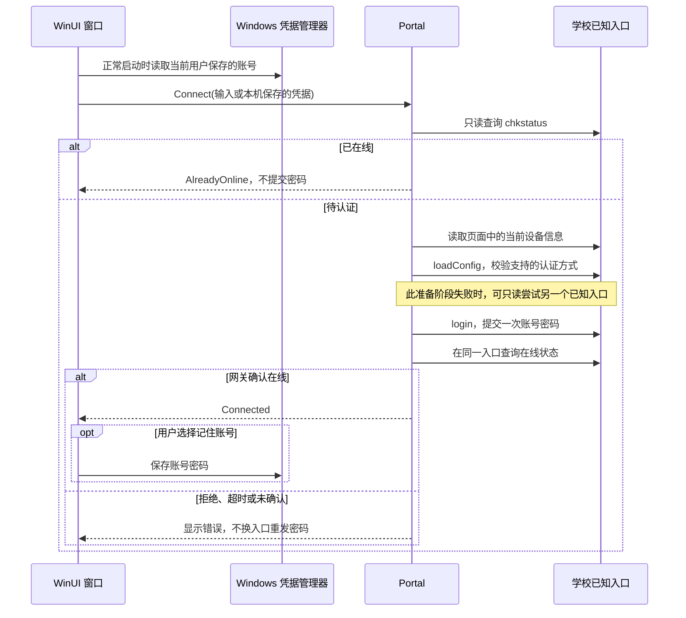

# 认证架构与凭据处理

本文对应 CampusLink 1.1.4，说明源码中实际实现的行为。CampusLink 是学校 Dr.COM 网页认证流程的本机客户端；认证是否成功、账号权限、计费及在线会话由学校系统决定。它不会绕过账号校验，也没有自己的云端账号服务。

## 组件与代码入口

| 组件 | 主要职责 | 源码 |
| --- | --- | --- |
| WinUI 窗口 | 读取输入、加载本机凭据、自动登录、显示结果、注销确认 | [MainWindow.xaml.cpp](../src/MainWindow.xaml.cpp)：`OnLoaded`、`InputCredentials`、`Run`、`OnLogout`、`RunLogout` |
| 认证协调器 | 发现入口、读取当前设备信息与配置、提交登录/注销、核对网关状态 | [Portal.cpp](../src/Portal.cpp)：`Portal::Check`、`Connect`、`Disconnect`；[Portal.hpp](../src/Portal.hpp) |
| HTTP 传输 | 限定目标地址和端口、编码参数、发送请求、报告传输错误 | [Portal.cpp](../src/Portal.cpp)：`GatewayHost`、`RequestPort`、`BuildPath`、`HttpRequestAt` |
| 本机存储 | Windows 凭据管理器、非敏感偏好、当前用户自启项、注销阶段日志 | [Store.cpp](../src/Store.cpp)、[Store.hpp](../src/Store.hpp) |
| 回归测试 | 注入模拟传输，验证请求次数、入口选择、结果确认、凭据与诊断边界 | [CoreTests.cpp](../tests/CoreTests.cpp) |

`Transport` 和 `GatewayTransport` 是可注入的函数类型。正式运行使用 WinHTTP；测试替换传输函数，因此大部分协议测试不依赖真实校园网，也不会提交真实密码。

## 目标地址与请求

`GatewayHost` 只接受两个枚举值，对应已确认的学校内网入口：

- 常用入口：`172.17.1.90`，页面路径 `/`。
- 有线入口：`172.31.0.10`，页面路径 `/a79.htm`。

当前不提供任意服务器地址输入。下载页面、重定向或其他同学的网址参数不能自行增加密码接收方。实现禁用 WinHTTP 代理、自动重定向和 Cookie，不执行学校返回的 JavaScript。

| 操作 | 路径 | 端口 | 是否提交用户密码 |
| --- | --- | --- | --- |
| 在线状态 | `/drcom/chkstatus` | 80 | 否 |
| 认证页面 | `/` 或 `/a79.htm` | 80 | 否 |
| 当前认证配置 | `/eportal/portal/page/loadConfig` | 801 | 否 |
| 登录 | `/eportal/portal/login` | 801 | 是 |
| 普通 Portal 注销 | `/eportal/portal/logout` | 801 | 否，使用网页协议的固定兼容值 |
| 旧式本地注销 | `/drcom/logout` | 80 | 否 |
| 查找当前设备绑定 | `/eportal/portal/mac/find` | 801 | 否 |
| 解除当前设备认证绑定 | `/eportal/portal/mac/unbind` | 801 | 否 |

路径映射见 `BuildPath`，端口映射见 `RequestPort`。所有请求均为 HTTP GET，响应要求 HTTP 200，正文上限为 2 MiB。HTTP 传输错误包含入口、操作、阶段和 Windows/HTTP 错误码，不附完整请求 URL 或响应正文。

## 登录请求流程

具体规则见 `Portal::Check` 与 `Portal::Connect`：

1. 优先检查当前窗口最近选定的入口；新窗口默认先检查常用入口。连接失败或状态格式不匹配时，再尝试另一个已知入口。`failedProbeMask_` 只记录本轮发现中失败的入口，每轮重新发现时清零。
2. 状态接口只接受 `result` 为 `0` 或 `1`。`1` 表示已经在线，此时立即返回，不验证或再次提交输入框中的密码。
3. 离线时，`ParseContext` 从当前页面读取 IP、MAC 和 VLAN；部分字段可从状态响应补充。无有效 IPv4 时停止；无有效 MAC 时使用协议占位值。不会复用其他同学反馈中的设备参数。
4. `LoadConfig` 查询当前设备的配置。登录仅接受 `login_method=1` 或 `9`。首入口虽能回答状态，但无法提供设备信息、配置或受支持的认证方式时，可在提交密码前尝试另一个尚未失败的入口。
5. 若配置要求账号前缀，按 `custom_perceive` 选择 `,b,` 或 `,0,`，再拼接原账号与 `account_suffix`。密码保持用户输入值，不自行拼接运营商或加密字段。
6. `login` 只提交一次。拒绝、未知传输结果、登录后的状态确认失败，都不会自动换入口重发密码。成功响应后最多查询三次在线状态，仍未在线则返回“尚未确认”。

开机模式只在最初的只读状态检查遭遇网络错误时有限等待，最多四轮检查，轮次间等待两秒。它不循环提交登录密码。手动登录没有这段等待。有关触发条件见 `MainWindow::OnLoaded`、`Run` 及[使用说明](../使用说明.txt)。

“保存账号”按钮可独立写入本机凭据；自动保存发生在新登录已被网关确认之后。已经在线时，程序会跳过认证，也不会据此判断新填写的密码正确。

## 参数、JSONP 与会话令牌

`Portal::Api` 统一加入 `callback=campusLogin`、`jsVersion=4.2`、`lang=zh-cn` 和 `v=GetTickCount64()`。

- `callback` 是 JSONP 回调名。`ParseJsonp` 只接受该名称及其包裹的合法 JSON，允许末尾分号；额外脚本、其他回调或无效 JSON 会被拒绝。它不使用 `eval` 或 JavaScript 引擎。
- `jsVersion` 和 `lang` 是学校接口的兼容及语言参数。
- `v` 是请求变化参数，可用于避免缓存。它不是密码、登录令牌、随机安全 nonce 或签名。
- 配置查询中的设备 IPv4 使用 Base64 编码。Base64 不提供保密性。

**客户端没有实现 OAuth、JWT、API key、访问令牌、刷新令牌或 Cookie 登录会话。** WinHTTP 明确禁用 Cookie。每次操作依靠学校返回的状态、设备上下文和配置；学校服务端怎样关联和维护网络会话属于其内部实现，不能从客户端源码推断为某一种令牌机制。

## 凭据在本机怎样处理

`ReadCredentials`、`WriteCredentials` 和 `ForgetCredentials` 调用 Windows `CredReadW`、`CredWriteW`、`CredDeleteW`，使用 `CRED_TYPE_GENERIC`，默认目标名为 `CampusLink.KashiUniversity.v1`。

账号保存在凭据记录的 `UserName`，密码以 UTF-16 字节写入 `CredentialBlob`。程序将持久化和本机存储保护交给 Windows；没有自己的主密码、内置解密密钥或云端备份。

`CRED_PERSIST_LOCAL_MACHINE` 表示记录在**本机、当前 Windows 用户**下跨登录会话保留，不表示电脑所有用户共享。以同一 Windows 用户运行的其他程序仍可能访问相应凭据，它不是只允许 CampusLink 读取的程序级保险箱。安装版和便携版使用相同目标名，因此在同一用户下共用账号。

本机其他状态分开保存：

| 数据 | 保存位置与内容 |
| --- | --- |
| 偏好 | `%LOCALAPPDATA%\CampusLink\settings.json`，仅保存 `autoLogin`、`autoClose` 布尔值 |
| 开机启动 | 当前用户 `HKCU\Software\Microsoft\Windows\CurrentVersion\Run` 下的 `CampusLink` 项，仅包含加引号的 EXE 路径和 `--startup` |
| 注销日志 | `%LOCALAPPDATA%\CampusLink\last-logout.log`，只记录固定阶段与时间 |

清除本机账号会关闭自启并删除凭据，但不修改学校密码、不注销当前网络。注销默认保留凭据；卸载默认也保留凭据，以免影响同一用户的便携版。

`Credentials` 禁止复制、允许移动，析构时尽力清零密码缓冲区；`Portal::Api` 在成功或异常路径清理查询参数中的密码；`HttpRequestAt` 在发送后清理请求路径；`Encode` 清理中间 UTF-8 缓冲区；`ReadCredentials` 在释放 Windows 返回的记录前清理其密码缓冲区。

这些是**尽力降低残留**的措施，不能保证进程内不存在明文或所有历史副本都已消失。WinUI 输入控件、字符串临时对象、运行库、WinHTTP、系统内存和崩溃转储仍可能持有数据。程序没有安全内存分配器，也不能抵御已经控制当前用户会话或进程的攻击者。

## HTTP 传输的实际限制

`Encode` 先把字符串转换为 UTF-8，再对参数进行百分号编码，以防 `&`、`+`、中文等破坏查询结构。**URL 编码不是密码加密。** 登录密码位于 HTTP GET 查询字符串中；HTTP 没有 TLS 的保密与服务端身份校验保障，网络路径上的观察者、学校服务器及其访问日志可能接触该信息。

地址白名单、禁用重定向和不输出完整 URL 有助于限制客户端的行为，但不能替代 HTTPS。该实现沿用已核对的学校接口，不应被描述成端到端加密或“密码绝不可能泄漏”。不要把完整认证 URL、抓包、进程转储或含真实账号的截图直接提交到公开 Issue。

`FailureMessage` 会移除简单 HTML 标签、将响应中与输入密码完全相同的文本替换为 `***`，并限制消息长度。这不是对任意编码、变形或其他个人信息的通用脱敏器。

## 注销与设备绑定

`MainWindow::OnLogout` 先弹出确认框。确认后，`Portal::Disconnect` 重新检查当前在线状态、设备上下文和学校配置；已离线时不提交变更。

当 `un_bind_mac=1` 且 `register_mode` 属于 `1`、`3`、`4` 时，程序采用学校网页的解绑流程：

1. 账号取当前状态响应的 `uid`，不读取保存的密码或用输入框账号代替。
2. 优先使用当前上下文的有效 MAC；缺失时调用只读 `mac/find`。
3. `FindCurrentMac` 只接受 `online_ip` 等于当前设备 IP 的条目；不选择列表第一项、不操作其他 IP，存在冲突也停止。
4. 将 MAC 转成大写，IPv4 转为无符号十进制，提交一次 `mac/unbind`。

只有解绑明确返回拒绝时，才按当前配置回退到普通注销。传输超时或响应无法识别意味着结果未知，不再追加另一次变更。普通 Portal 注销中出现的 `user_account=drcom`、`user_password=123` 是学校网页协议的固定兼容值，**不是开发者密码、用户保存的密码或可授予额外权限的秘密**。旧式本地注销只在对应配置下使用 `/drcom/logout`。

注销后始终在已选入口核对状态，最多查询十二次；连续两次离线才报告成功。一次查询离线不算确认。每种变更最多提交一次，但“解绑明确拒绝后普通注销”可能各产生一次请求。参见 `Disconnect` 和 `RunLogout`。

## 诊断、测试与验证边界

`DiagnoseNetwork` 只对两个已知入口调用状态、页面和配置接口，不登录、不注销、不查保存的账号密码。读取配置时仍需向学校发送当前设备的上下文参数，但显示出的报告只包含入口、接口连通结果、是否在线、认证类型是否受支持，以及固定错误阶段和错误码；不会输出账号、密码、设备 IP、MAC 或原始响应。

报告默认只在窗口中显示；`OnDiagnose` 只有在用户点击“复制结果”时写入剪贴板，不自动上传。演示模式使用模拟响应，并明确标注“模拟结果”。注销日志也不保存请求参数或原始响应。

[CoreTests.cpp](../tests/CoreTests.cpp) 覆盖编码、严格 JSONP、动态上下文、在线跳过、拒绝后不重试、未知结果不重发、入口切换与固定、网络恢复、设备匹配、诊断隐私等。凭据测试使用独立的 `CampusLink.Test.*` 目标；自启测试使用独立测试注册表键，并清理测试数据。

真实网络检查需与模拟测试区分：

- `CampusLink.Tests.exe --live` 只查询学校状态，输出可达及在线布尔值。
- `CampusLink.Tests.exe --check-logout-route` 允许必要只读查询，但在准备发送真实注销或解绑请求前拦截，不实际注销。
- 应用 `--demo-*` 模式不读取保存的凭据、不发送真实认证请求；`--smoke-test` 只查询状态并退出。
- “入口可达、当前在线、配置受支持”不等于已验证从离线开始的自动登录，更不等于其他区域的认证配置全部兼容。实际验证范围见 [README](../README.md)。

新增网关、认证方式或注销路径时，应同步更新本说明和相应模拟测试，明确密码提交前后的边界，避免将只读发现的重试扩展成凭据重发。
